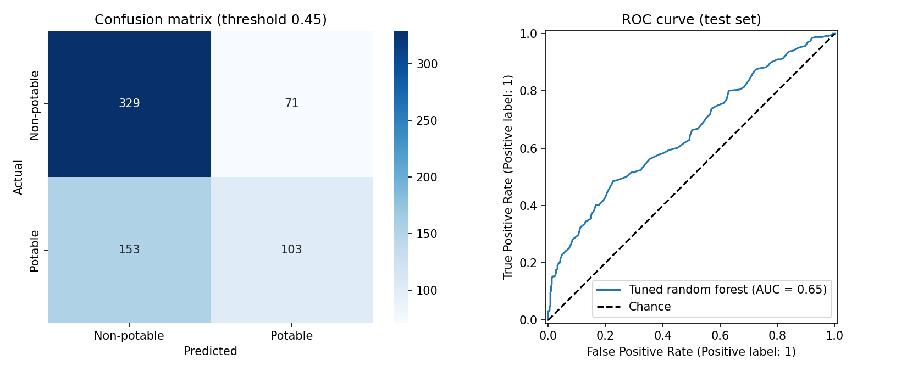
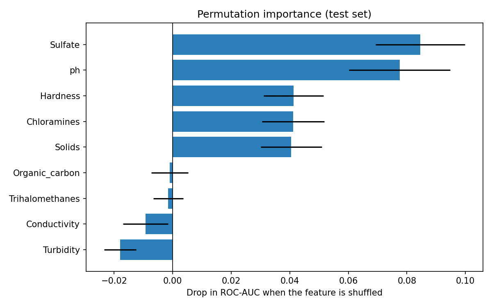

# Water Potability Prediction

Classification of water samples as potable or non-potable from 9 physicochemical
measurements, with a strict evaluation: one stratified split, preprocessing fitted on
training data only, cross-validated tuning, a majority-class baseline and bootstrap
confidence intervals.

## Background
Originally a team case study at TH Deggendorf (Applied AI for Digital Production
Management, Prof. Dr. Sunil Survaiya) comparing a Random Forest and H2O AutoML on
the Kaggle Water Potability dataset. This repository is my re-implementation with a
corrected evaluation. My part in the original project: [...]

## Data
Water Potability (Aditya Kadiwal, Kaggle): https://www.kaggle.com/datasets/adityakadiwal/water-potability

- 3,276 samples, 9 features (pH, hardness, solids, chloramines, sulfate, conductivity,
  organic carbon, trihalomethanes, turbidity), about 39% potable
- Missing values in sulfate, pH and trihalomethanes (median imputation, fitted on training data only)
- The dataset is not included. Download it and place it in `data/`.

## Method
1. Stratified 80/20 split (seed 42): 2,620 training and 656 test samples. The test set is used once, at the end.
2. Pipelines for imputation, scaling and model, so nothing is fitted on test data.
3. 5-fold stratified cross-validation on the training set to compare a majority-class baseline, logistic regression, decision tree, random forest and gradient boosting (ROC-AUC from predicted probabilities).
4. Random forest tuned by grid search on the training set (max depth 5 / 10 / unlimited, min samples per leaf 1 / 3, 200 trees), scored by cross-validated ROC-AUC. The best parameters are printed in the notebook.
5. Decision threshold (0.45) chosen from out-of-fold training predictions.
6. 95% bootstrap confidence intervals on the test set.

## Results

| Model | CV ROC-AUC | Test accuracy | Test ROC-AUC | Potable recall |
|---|---|---|---|---|
| Baseline (always non-potable) | 0.500 | 0.610 | 0.500 | 0.00 |
| Logistic regression | 0.477 ± 0.018 | 0.524 | 0.547 | 0.53 |
| Decision tree (depth 5) | 0.578 ± 0.035 | 0.649 | 0.604 | 0.22 |
| Random forest (default) | 0.686 ± 0.015 | 0.666 | 0.657 | 0.32 |
| Gradient boosting | 0.667 ± 0.015 | 0.655 | 0.662 | 0.38 |
| Random forest (tuned), threshold 0.50 | 0.682 | 0.663 | 0.653 | 0.34 |
| Random forest (tuned), threshold 0.45 | 0.682 | 0.659 | 0.653 | 0.40 |

Tuned random forest on the test set (n = 656): accuracy 0.663 (95% CI 0.628 to 0.698)
versus 0.610 for the baseline; ROC-AUC 0.653 (95% CI 0.610 to 0.695). The CV ROC-AUC of
the tuned model is its best grid-search score and is slightly optimistic.

Findings
- The features carry limited signal. Tree ensembles reach about 0.65 to 0.69 AUC; logistic regression is no better than chance (CV AUC 0.48).
- Tuning gave no gain over the default forest (CV AUC 0.682 vs 0.686, within noise). Random forest and gradient boosting are statistically indistinguishable.
- At threshold 0.45 the tuned model finds 40% of potable samples with 59% precision, so about 4 in 10 samples predicted potable are not. It is not suitable as a safety decision tool, at most a screening aid for prioritising lab tests.
- The original case study reported 71.3% accuracy on a 164-sample test set; with a larger test set and no split selection on test accuracy, the estimate is about 66%.

[One sentence on which features matter most, after you look at the importance plot.]

## Limitations
- One public dataset; no external validation on samples from other regions or sources.
- Modest test set (656 samples); the confidence intervals above show the uncertainty.
- Median imputation of missing values; no feature engineering.
- The model's low recall and precision on potable samples make it unsuitable for deciding whether water is safe.

## How to run
1. `pip install -r requirements.txt`
2. Download the dataset from the Kaggle link and place it at `data/drinking_water_potability.csv`
3. Open `water_potability_analysis.ipynb` and run all cells

## Files
- `water_potability_analysis.ipynb`: full pipeline and evaluation
- `results.csv`: test-set results table
- `images/`: plots
- `requirements.txt`: Python packages
